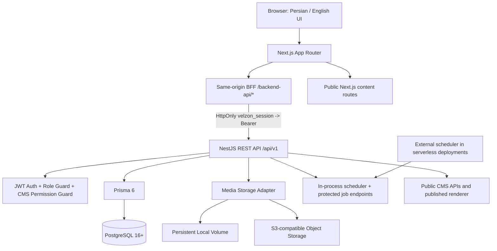

# Enterprise CMS Architecture

## Deployment model

The supported target for this release is one installation per customer organization. Each installation has its own Next.js application, NestJS API, PostgreSQL database, secrets and media bucket/volume. The schema is not multi-tenant; tenant IDs and cross-tenant isolation are intentionally deferred.

## Runtime components

## Authentication boundary

- Browser sign-in posts to `/backend-api/auth/login`.
- The BFF receives the backend access token and sets a host-only `velzon_session` cookie with HttpOnly, SameSite=Lax, Path=/ and a maximum 15-minute lifetime; Secure is enabled in Production.
- The BFF removes accessToken from the response body and forwards browser API calls to NestJS with a server-generated Bearer header.
- Browser-supplied Authorization headers are ignored.
- A protected API 401 expires the cookie; 403 does not clear a valid session.
- The backend verifies JWT and performs authorization. Middleware cookie-presence checks are routing gates, not cryptographic authentication.

## Data boundaries

- PostgreSQL stores users, predefined roles, CMS permissions, content types/fields, content records, localized translations, revisions, publication snapshots, media metadata, taxonomies/terms, menus, redirects, forms/submissions, webhook configuration/delivery records and audit records.
- Content field values are JSON-backed and validated against the current content type field definitions.
- Published snapshots are served independently from in-progress draft edits.
- Media binaries are stored behind a storage adapter; the database stores metadata and storage keys.
- Webhook payloads are signed with HMAC-SHA256. Delivery records live in PostgreSQL.

## Role and permission model

The role names are a Prisma enum, not customer-created role records. Permission codes are stored in the CMS permission catalogue and grants are represented by CMS role-permission rows. ADMIN and SUPER_ADMIN bypass CMS action grants. Other roles are checked against explicit grants. User administration currently permits role and active-state changes for privileged administrators; invitation and recovery workflows are not included.

## Public rendering

- The public content route is `/content/:typeKey/:localeCode/:slug`.
- Only published content and its published snapshot are eligible for anonymous public rendering.
- Localized metadata, canonical/hreflang alternates and sitemap data are provided by CMS APIs.
- The included renderer treats author content as structured data/text. Raw arbitrary HTML/JavaScript is not an enabled publishing capability.

## Background jobs

Scheduled publishing and webhook dispatch have in-process workers and token-protected endpoints under `/api/v1/internal/cms/jobs/*`. A serverless deployment must invoke these endpoints from an external scheduler using `CMS_JOB_TOKEN`. A durable distributed queue and multi-instance lease/ownership strategy still require further implementation and verification.

## Non-goals for this version

- Shared multi-tenant SaaS database.
- Arbitrary custom HTML/JavaScript publishing.
- Full visual drag-and-drop website design system.
- Full CRM/e-commerce/project/ticket replacement of every Velzon template demo.
